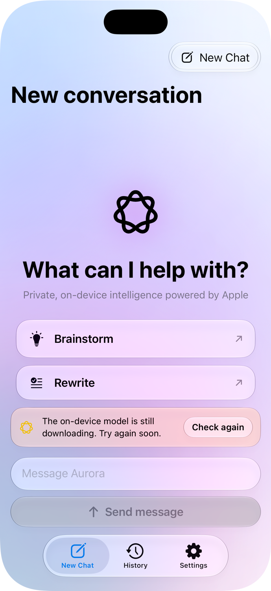
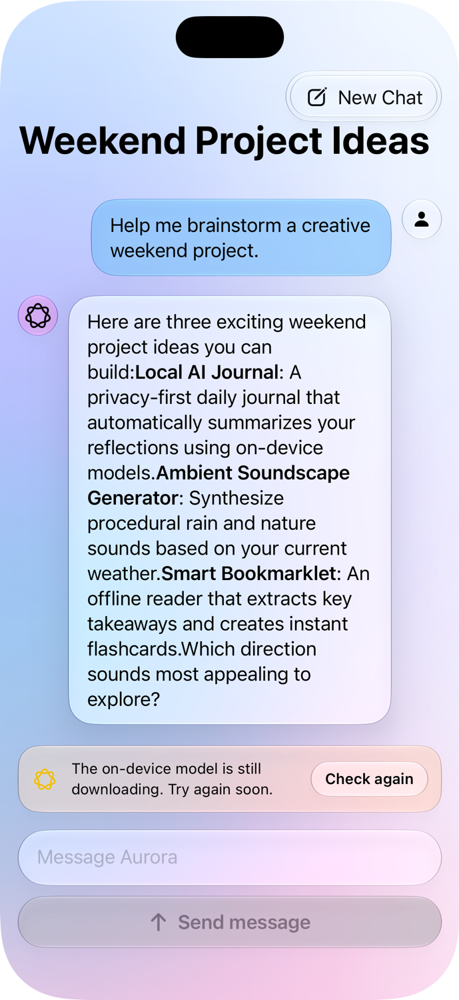
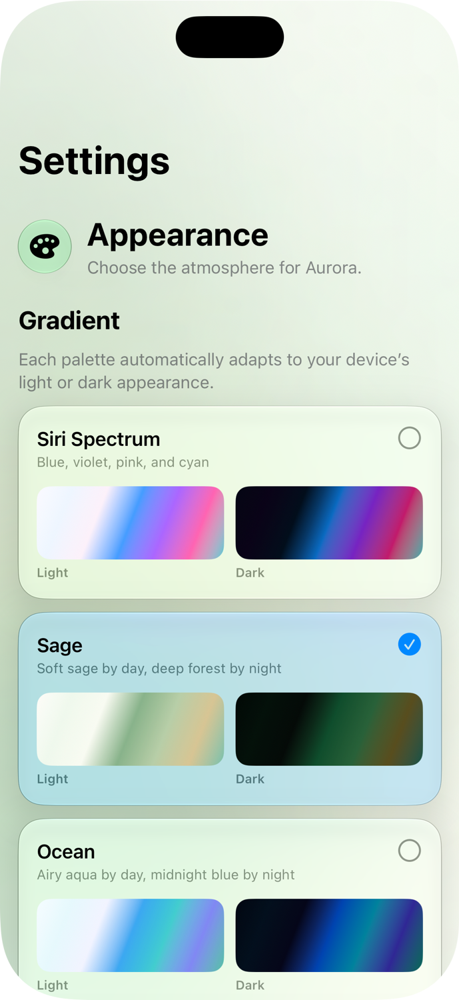
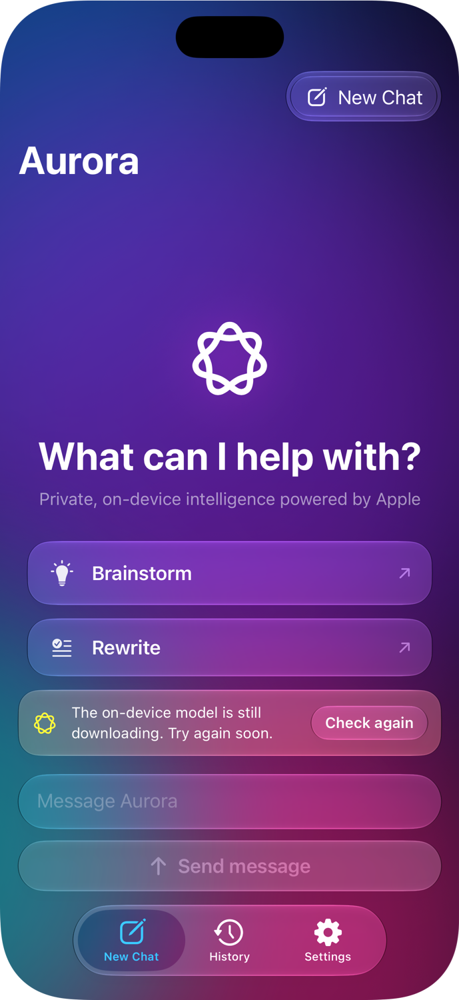
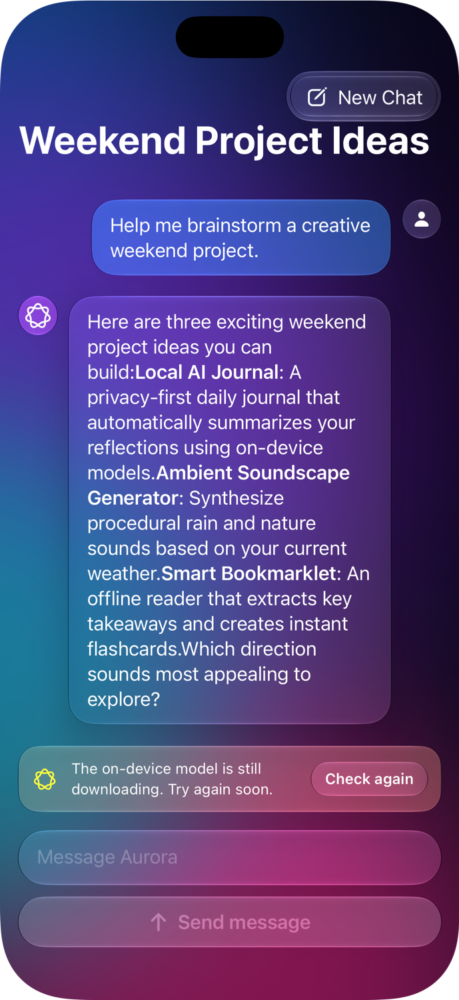
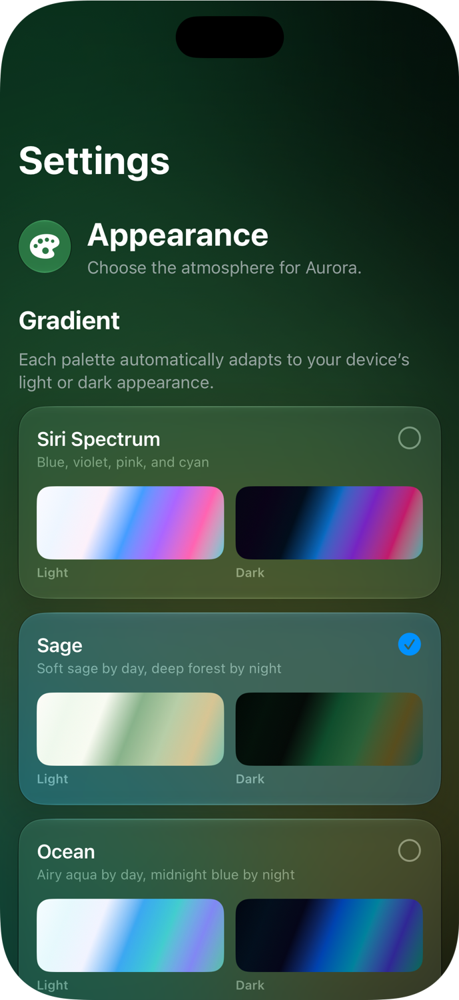

# Aurora 🌌

> **Private, on-device conversational intelligence powered by Apple FoundationModels and SwiftUI.**

Aurora is a modern iOS assistant designed with privacy, aesthetics, and fluid interaction at its core. By leveraging Apple's native **FoundationModels** framework, Aurora executes all language model inference locally on your Apple Silicon hardware—ensuring your conversations and personal data never leave your device.

---

## 📸 Screenshots

### Light Appearance

| Welcome & Suggestions | Active Chat Conversation | Theme & Atmosphere Settings |
|:---:|:---:|:---:|
|  |  |  |

### Dark Appearance

| Welcome (Dark) | Conversation (Dark) | Settings (Dark) |
|:---:|:---:|:---:|
|  |  |  |

---

## ✨ Features

- **🔒 100% On-Device & Private**: Driven by `SystemLanguageModel.default` and `LanguageModelSession` via Apple's `FoundationModels`. Zero cloud dependencies, zero latency from network roundtrips, and absolute privacy.
- **✨ Liquid Glass Design**: Implements Apple's next-generation Liquid Glass visual materials (`.glassEffect`, `GlassEffectContainer`, `.buttonStyle(.glass)`, and `.buttonStyle(.glassProminent)`).
- **🎨 Dynamic Siri Gradient Atmosphere**: Fluid, animated Siri-inspired gradient backgrounds with customizable palettes:
  - *Siri Spectrum*
  - *Aurora Borealis*
  - *Sunset Glow*
  - *Neon Cyber*
  - *Forest Sage*
  - *Midnight Abyss*
- **⚡ Real-Time Response Streaming**: Instantaneous token generation feedback with animated thinking indicators and native markdown parsing.
- **💬 Conversation History & Search**: Automatically archives conversation transcripts locally with persistent storage (`ConversationArchive`) and full-text keyword search.
- **🛡️ Model Readiness & Health Monitoring**: Automatic runtime verification of Apple Intelligence availability, offering clear user guidance if models are preparing, downloading, or disabled in system settings.

---

## 🏗️ Architecture & Project Structure

The project follows a clean, decoupled SwiftUI architecture with Swift 6 strict concurrency:

```
Aurora/
├── Aurora/
│   ├── MyApp.swift                   # Application entry point (@main)
│   ├── ContentView.swift             # Primary tab navigation (New Chat, History, Settings)
│   ├── ChatViews.swift               # UI components (ChatScreen, WelcomeView, MessageList, Composer)
│   ├── ChatStore.swift               # @Observable central state container managing model sessions
│   ├── ChatModels.swift              # Domain models (ChatMessage, ChatConversation, AvailabilityState)
│   ├── ConversationArchive.swift     # Disk persistence & JSON serialization
│   ├── SiriGradientBackground.swift  # Procedural mesh gradient rendering & theme definitions
│   ├── SettingsView.swift            # Atmosphere theme selection & appearance settings
│   ├── Assets.xcassets               # App assets & color sets
│   ├── aurora.icon/                  # App icon definitions
│   └── Info.plist                    # App metadata
└── screenshots/                      # Application preview screenshots
```

---

## 🛠️ Requirements & Prerequisites

| Requirement | Specification |
|:---|:---|
| **Platform** | iOS 18.0+ / iOS 26+ |
| **IDE** | Xcode 16.0+ |
| **Language** | Swift 6.0 |
| **Frameworks** | SwiftUI, FoundationModels, Observation |
| **Hardware** | Apple Intelligence capable device (iPhone 15 Pro / 16+, iPad/Mac with Apple Silicon M-series) |

---

## 🚀 Getting Started

1. **Clone the repository:**
   ```bash
   git clone https://github.com/suntsarac/Aurora.git
   cd Aurora
   ```

2. **Open in Xcode:**
   ```bash
   open Aurora.xcodeproj
   ```

3. **Select a Target & Destination:**
   - Choose the `MyApp` scheme.
   - Select an Apple Intelligence supported simulator (e.g., iPhone 16 Pro) or a physical device with Apple Intelligence enabled.

4. **Build and Run:**
   - Press `Cmd + R` to build and launch Aurora.

---

## 📜 License

This project is licensed under the MIT License. See [LICENSE](LICENSE) for details.
